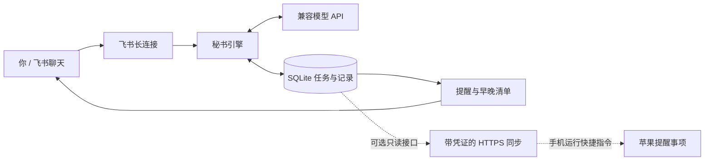

<div align="center">


# Personal-life-secretary

**飞书里的个人生活秘书 · outsourced brain**

把随口说出的计划，变成记得住、能调整、会提醒的待办。

[](https://github.com/Markliwithcan/Personal-life-secretary/actions/workflows/ci.yml)


[](LICENSE)


[快速开始](#本地启动) · [功能概览](#功能概览) · [苹果提醒事项](#苹果提醒事项可选) · [部署](DEPLOYMENT.md) · [隐私](PRIVACY.md)

</div>

---

## 从一句话开始

> **你：** 我接下来有半小时空闲，可以做什么？<br>
> **秘书：** 根据已有待办和已知时间，给出下一步建议。需要调整计划时，先给草案，确认后再执行。

这是一个自托管的聊天秘书：通过飞书接收消息，使用兼容 OpenAI Chat Completions 的模型理解语义，用 SQLite 保存任务和提醒。面向个人或可信的小团队，当前为早期版本。

## 功能概览

| | 能做什么 |
| :--- | :--- |
| 💬 **自然聊天** | 创建、改期、完成事项；按描述拟取消，匹配不明确时询问 |
| 🧭 **下一步建议** | 根据空闲时间与已有任务给建议；支持部分完成、剩余工作量和确认后的分摊计划 |
| 🌤️ **简洁早晚清单** | 默认 09:30 看今天、21:30 看明天；只显示非空栏目，无事项时不打扰 |
| 🔔 **持久化提醒** | 免打扰时段、断线恢复后的补发、任务变更后旧提醒失效 |
| 👥 **多人各自管理** | 按应用、会话与用户隔离；指定群可为明确指定的成员代加任务 |
| 📥 **计划表导入** | Excel / CSV 先预览，再确认导入 |
| 🔎 **漏记复查** | 启动及每日 09:00、21:00 检查当天已保存消息，候选事项确认后才创建 |
| 🍎 **苹果提醒事项桥接** | 可选只读同步 API + 快捷指令搭建流程；手机授权与实机验证仍需完成 |

所有时间使用配置时区。群聊无需 @ 需开通飞书全量群消息权限；只处理白名单成员与群。私聊和群内待办分开。

## 工作原理



模型理解意图，程序校验与保存变更。任务不明确就询问；批量破坏性操作、排程草案需确认。描述式取消先标记为拟取消，晚间通知成功后满 24 小时未修改才正式取消，期间可恢复。

### 一天的秘书节奏


不会因为你没回复就判定任务没完成，也不会擅自改截止时间。每日消息省去固定操作教程，仍保留必要的时间和进度问题。详见 [秘书能力说明](SECRETARY.md)。

## 苹果提醒事项（可选）

**本次新增：秘书 → 苹果提醒事项的单向同步基础。**

- 每台设备使用独立凭证，仅读取配置范围内的任务；服务端保存凭证哈希。
- 稳定任务标记与内容指纹供快捷指令识别新增、变更和取消，避免反复新增同一事项。
- 完成情况仍在飞书确认；手机上的勾选不会反向修改秘书数据库。
- 未确认的提醒时间不擅自设闹钟；拟取消时停止手机闹钟。

> **交付状态：** 本地接口、配对工具和自动化测试已完成；提供快捷指令搭建说明，尚无可直接安装的签名快捷指令，尚未完成 iPhone 实机验收。公网使用需部署 HTTPS，服务默认关闭。不是飞书原生集成，也不保证手机后台实时同步。

[查看手机配置与验收步骤 →](APPLE_REMINDERS.md)

## 本地启动

需要 Node.js 24、Python 3.10+。

```bash
npm ci
python3 -m venv .venv
.venv/bin/pip install -r requirements-cloud.txt
cp assistant.example.json assistant.local.json
cp feishu.example.json feishu.local.json
```

Windows 使用 `python -m venv .venv` 和 `.venv\Scripts\pip.exe`。Linux 设置 `ASSISTANT_PYTHON` 为虚拟环境 Python 的绝对路径；Windows 默认使用项目下的 `.venv\Scripts\python.exe`。

在本地配置文件中填入模型配置、飞书 App ID 和 App Secret，不要提交它们。

飞书后台：启用机器人，导入 `feishu-scopes.json`，选择长连接，订阅 `im.message.receive_v1`，发布版本并确保权限审批生效。

```bash
export ASSISTANT_PYTHON="$PWD/.venv/bin/python"
npm start
```

### 成员绑定

初始 `allowed_users` 为空，消息不会交给模型或建立任务。用户先向机器人发送单聊消息，或在目标群发送消息；管理员在本机 `data/feishu/state.json` 的 `unbound` 查看账号和群 ID，经身份核对后更新配置：

```json
{
  "app_id": "YOUR_APP_ID",
  "app_secret": "YOUR_APP_SECRET",
  "allowed_users": [
    {"open_id": "USER_A_OPEN_ID", "name": "用户甲"},
    {"open_id": "USER_B_OPEN_ID", "name": "用户乙"}
  ],
  "allowed_groups": ["GROUP_CHAT_ID"],
  "cross_assign_groups": ["GROUP_CHAT_ID"],
  "owner_open_id": "USER_A_OPEN_ID",
  "enabled": true
}
```

成员和群白名单会动态读取；绑定前的消息不自动重放，请绑定后重新发送。`owner_open_id` 为预留字段，不赋予跨用户读写权。
默认使用“提醒助手”作为机器人名称；群消息中的人名应与配置一致。仅在可信成员群开启代加功能。

## 使用例子

```text
添加 买牛奶
明天下午三点提醒我交材料
待办
取消 买牛奶
不取消 买牛奶
明天下午一点提醒用户甲阅读资料
测试提醒
```

编号仍兼容，但取消可以使用名称片段；多项匹配时询问。正式取消是逻辑归档，历史与备份不会自动擦除。

## 隐私和限制

仓库不包含部署者的账号绑定、密钥、聊天记录、待办或数据库；示例使用占位信息。配置和运行数据由部署者自行保管。

- 本地 SQLite **不加密**；这不是端到端加密产品，管理员能够访问文件。
- 配置云模型后，相关聊天、任务和记忆会发送给模型提供方；群回复对群成员可见。
- 飞书接入尚未实现音频转写，语音需转文字后发送。
- 只复查已接收的消息；尚未自动补取断线期间的全部历史。
- 单实例运行；不要让不同服务器同时处理同一应用和独立数据库。
- 模型可能误解或返回无效结构。建议先用非重要事项验证，不把此工具作为唯一提醒渠道。
- 跨用户代加是两个数据库间的操作，目前不具备分布式事务保证。
- 无管理员网页、自动账号注册、云托管服务或外部故障告警。

## 部署、测试与贡献

见 [部署说明](DEPLOYMENT.md)、[隐私说明](PRIVACY.md)、[贡献说明](CONTRIBUTING.md)。

```bash
npm test
python -m unittest test_parse_sheet.py
```

测试使用临时/内存数据库与虚构数据，不需要真实 App Secret、API Key 或联网调用模型。

MIT 许可；依赖项目保留各自许可证。本项目不属于飞书或 DeepSeek 官方产品。
